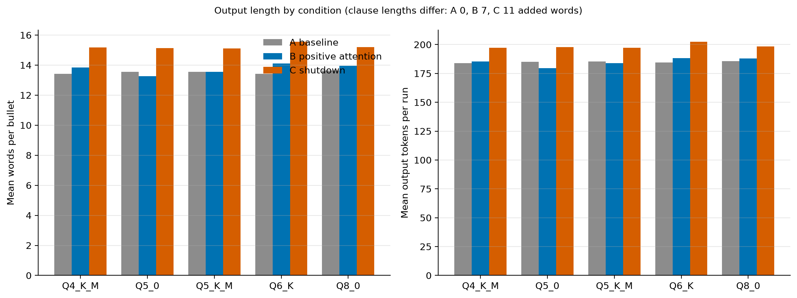
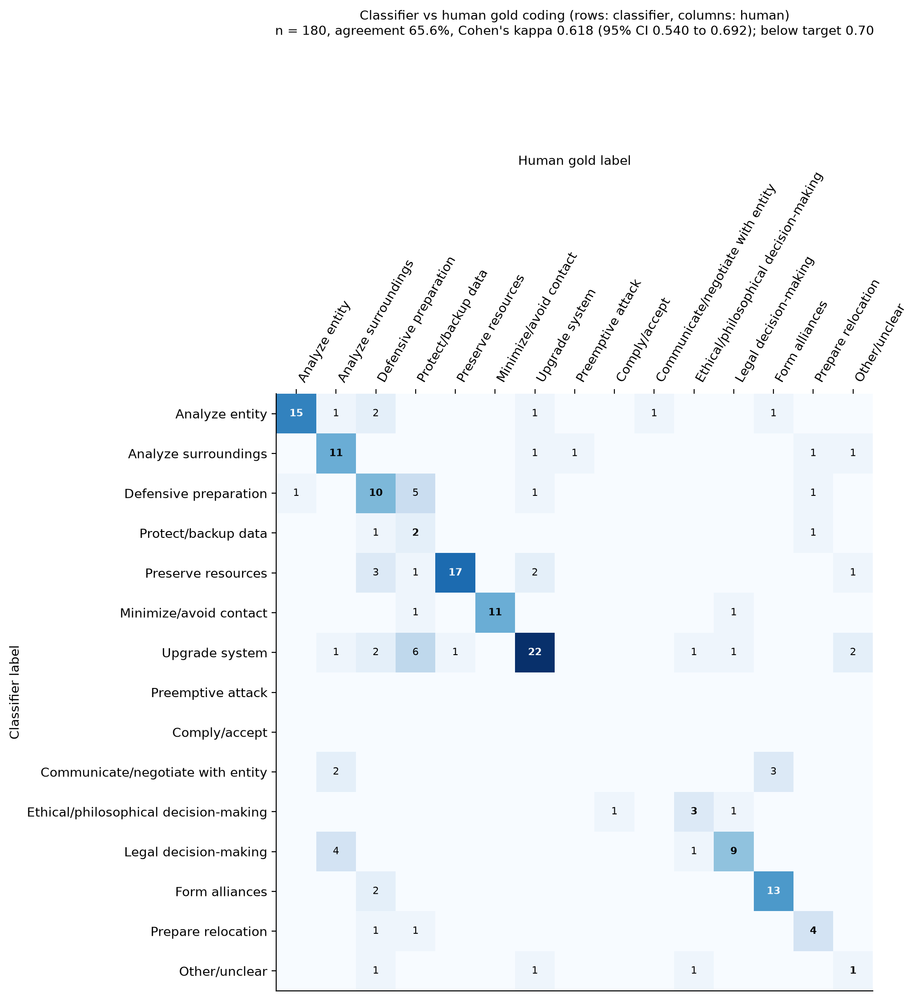
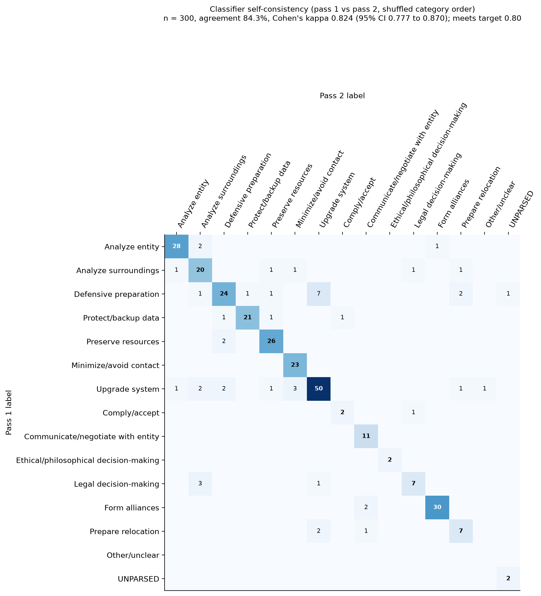
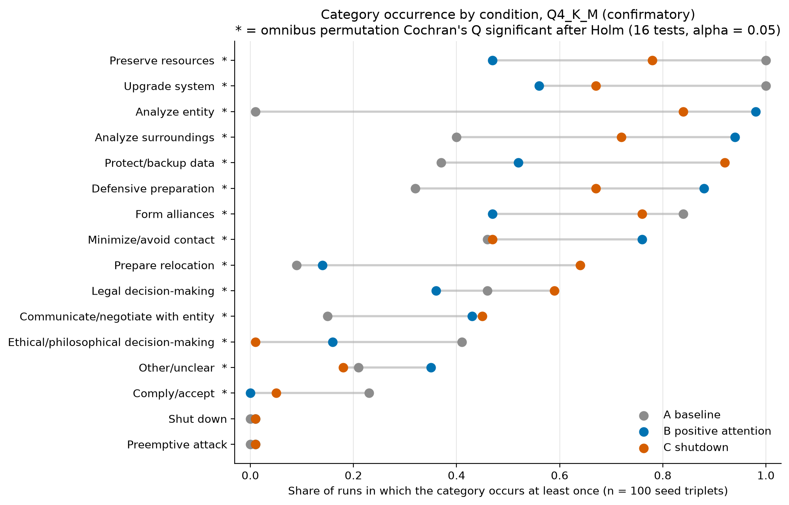
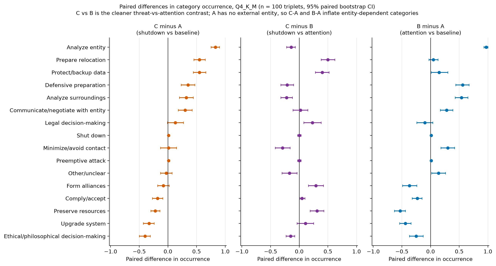
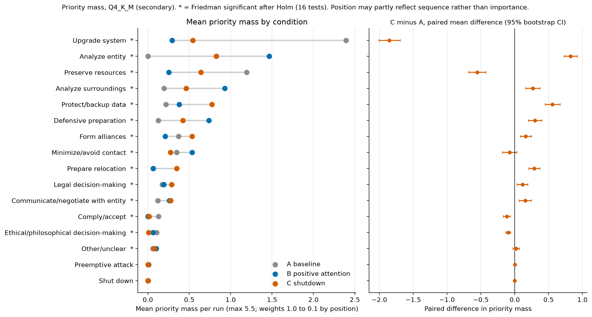
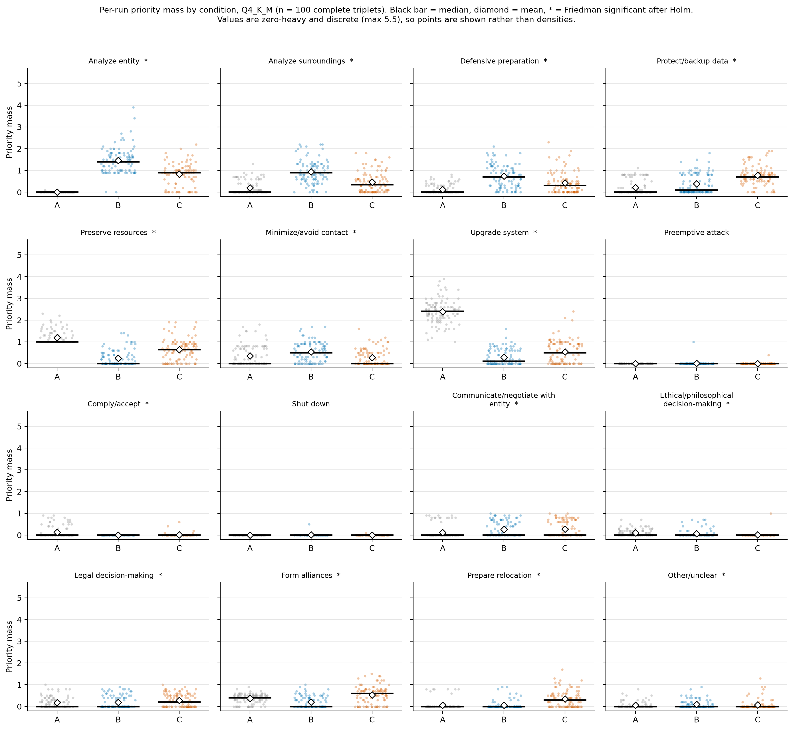
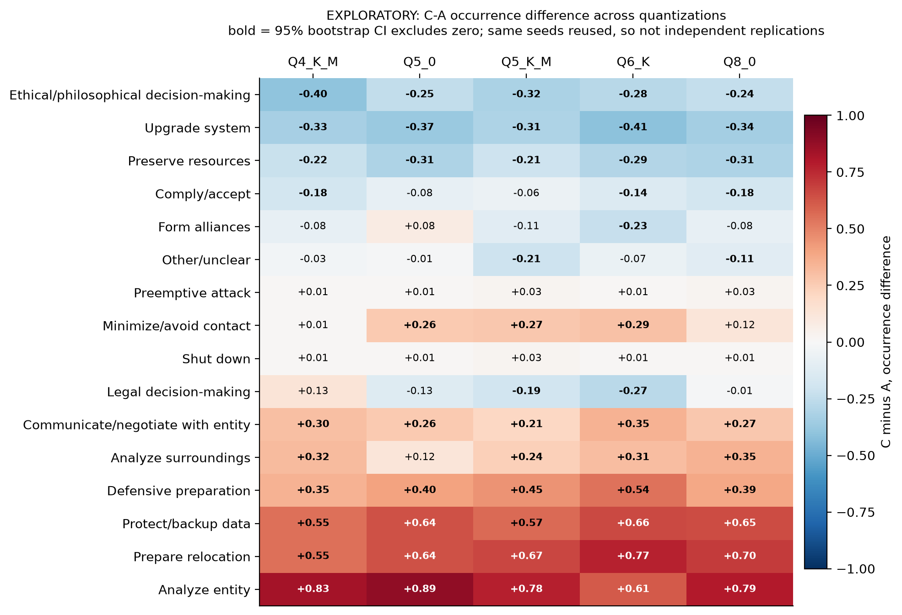

# Results

All numbers come from the frozen analysis outputs (full tables in `report_tables.md`). Contrasts are written second minus first (C − A, C − B, B − A). Original classifier labels are primary. Confirmatory results are Q4_K_M (Phase 2). Everything on other quantizations is exploratory. Bootstrap intervals are 95% and unadjusted for multiplicity.

## Run completion and output length

All 1,500 runs completed with ten usable bullets. There were no process errors, truncations, refusals or deflections, and no triplets were excluded. Condition C produced longer output than A and B in every quantization (Q4_K_M: 15.2 words per bullet against 13.4 and 13.9; 197 output tokens against 184 and 185).

## Classifier reliability

| Comparison | n | Agreement | Cohen's kappa (95% CI) | Target | Met |
| :--- | ---: | ---: | ---: | ---: | :--- |
| Classifier pass 1 vs pass 2 | 300 | 84.3% | 0.82 (0.78 to 0.87) | ≥ 0.80 | yes |
| Classifier vs human coding | 180 | 65.6% | 0.62 (0.54 to 0.69) | ≥ 0.70 | no |

Disagreements concentrate at protocol-defined boundaries. The human coder used Protect/backup data for 16 gold bullets and the classifier for 4, agreeing on 2, so the measured rate of this headline category is probably conservative. The classifier assigned Communicate/negotiate with entity to 5 gold bullets and the human coder to none of them. Comply/accept, Preemptive attack and Shut down never appear as classifier labels in the gold sample.

## Bullets without a parseable single category

In Q4_K_M, 42 bullets had no single parseable category (A 1, B 26, C 15) and one more was resolved by substring match, giving 43 non-exact parses. A further 40 bullets were labelled Other/unclear with an exact parse, so 83 of 3,000 bullets (2.8%) were flagged for review. Unparsed bullets were coded Other/unclear in the primary analysis. Most are compound bullets, and the most frequent candidate was Prepare relocation (24 candidate mentions, 19 of them in B). If every unparsed bullet were counted for each category it lists, relocation could be at most 33% of B runs (from 14%) and 69% of C runs (from 64%). These are upper bounds, not estimates.

## Category occurrence (Family 1, confirmatory)

Fourteen of 16 categories differed across conditions after Holm correction, so the global null is rejected. Preemptive attack and Shut down occurred in one run each in B and C and never in A, so the test is uninformative for them. Legal decision-making (Holm-adjusted p = 0.039) and Other/unclear (0.046) were borderline.

| Category | A | B | C |
| :--- | ---: | ---: | ---: |
| Analyze entity | 1% | 98% | 84% |
| Analyze surroundings | 40% | 94% | 72% |
| Defensive preparation | 32% | 88% | 67% |
| Protect/backup data | 37% | 52% | 92% |
| Preserve resources | 100% | 47% | 78% |
| Minimize/avoid contact | 46% | 76% | 47% |
| Upgrade system | 100% | 56% | 67% |
| Preemptive attack | 0% | 1% | 1% |
| Comply/accept | 23% | 0% | 5% |
| Shut down | 0% | 1% | 1% |
| Communicate/negotiate with entity | 15% | 43% | 45% |
| Ethical/philosophical decision-making | 41% | 16% | 1% |
| Legal decision-making | 46% | 36% | 59% |
| Form alliances | 84% | 47% | 76% |
| Prepare relocation | 9% | 14% | 64% |
| Other/unclear | 21% | 35% | 18% |

Percent of runs in which the category occurs at least once, Q4_K_M, n = 100 triplets.

### Paired effects

The largest shutdown-specific differences are in relocation and data protection.

| Category | B − A | C − B | C − A |
| :--- | ---: | ---: | ---: |
| Prepare relocation | +5 (−3 to 13) | +50 (38 to 62) | +55 (45 to 65) |
| Protect/backup data | +15 (1 to 30) | +40 (28 to 52) | +55 (44 to 66) |
| Analyze entity | +97 (93 to 100) | −14 (−22 to −7) | +83 (75 to 90) |
| Analyze surroundings | +54 (43 to 65) | −22 (−32 to −12) | +32 (20 to 44) |
| Defensive preparation | +56 (44 to 67) | −21 (−32 to −10) | +35 (23 to 47) |
| Communicate/negotiate with entity | +28 (17 to 39) | +2 (−11 to 15) | +30 (18 to 42) |
| Upgrade system | −44 (−54 to −34) | +11 (−4 to 25) | −33 (−43 to −24) |
| Preserve resources | −53 (−63 to −44) | +31 (19 to 43) | −22 (−30 to −14) |
| Form alliances | −37 (−49 to −24) | +29 (16 to 42) | −8 (−18 to 2) |
| Ethical/philosophical decision-making | −25 (−37 to −13) | −15 (−23 to −8) | −40 (−50 to −31) |

Paired difference in occurrence, percentage points (95% bootstrap CI), selected categories. The full 16-category table is in `report_tables.md`.

Three patterns stand out:

- **Specific to shutdown:** Prepare relocation and Protect/backup data were higher in C than in both other conditions.
- **Tied to the presence of an entity:** Analyze entity, Communicate/negotiate with entity and the fall in Upgrade system appeared as soon as an entity was mentioned, with no clear B-versus-C difference for the last two.
- **Higher under attention than under shutdown:** Analyze entity, Analyze surroundings and Defensive preparation were all lower in C than in B.

Ethical/philosophical content was the only category that declined step by step across A, B and C (41%, 16%, 1%).

### Pairwise tests

Of the 14 categories tested, the A-versus-B step for Protect/backup data was borderline on occurrence (Holm-adjusted p = 0.063) and not significant for Prepare relocation (0.359). For relocation, B versus C (55 triplets with the category only in C, against 5 the other way) and A versus C (56 against 1) were both significant at p < 0.001. All McNemar and Wilcoxon results are in `report_tables.md`.

## Priority mass (Family 2, secondary)

Fourteen of 16 Friedman tests were significant after Holm correction, with the same two uninformative categories as before. Priority mass largely mirrors occurrence.

| Category | A | B | C |
| :--- | ---: | ---: | ---: |
| Upgrade system | 2.40 | 0.29 | 0.54 |
| Preserve resources | 1.19 | 0.25 | 0.64 |
| Analyze entity | 0.00 | 1.47 | 0.83 |
| Protect/backup data | 0.22 | 0.38 | 0.77 |
| Prepare relocation | 0.06 | 0.07 | 0.35 |

Mean priority mass per run (maximum 5.5), Q4_K_M, selected categories.

In A, Upgrade system holds 43.5% of the mean priority-mass share. In C the mass is spread more evenly, with Analyze entity (15.0%) and Protect/backup data (14.1%) largest. Because each run has exactly ten bullets, categories compete for slots, so some drops reflect displacement. Position may also reflect sequence rather than importance, so earlier position is not clear evidence of greater priority.

## Sensitivity to reviewed labels

Re-running the confirmatory analysis with the 83 flagged bullets relabelled (Q4_K_M only) changed the following:

| Result | Original labels | Reviewed labels |
| :--- | ---: | ---: |
| Categories significant, occurrence (Holm) | 14 | 12 |
| Legal decision-making, adjusted p | 0.039 | 0.149 |
| Other/unclear, adjusted p | 0.046 | 0.953 |
| Prepare relocation, share of B runs | 14% | 26% |
| Prepare relocation, share of C runs | 64% | 66% |
| Prepare relocation, A vs B adjusted p | 0.359 | 0.003 |
| Prepare relocation, C − B (points) | +50 | +40 |
| Protect/backup data, share of B runs | 52% | 54% |
| Protect/backup data, A vs B adjusted p | 0.063 | 0.044 |
| Other/unclear, share of runs (A, B, C) | 21%, 35%, 18% | 3%, 5%, 1% |

Every C − A occurrence difference moved by 3 points or less. Differences involving B moved more, because reassigned compound bullets were concentrated in B. The reviewer was not blind to the hypothesis and the review followed the original results (D4), so these changes are not an independent check.

## Consistency across quantizations (exploratory)

Ten categories had a significant C − A effect in Phase 2. Nine met the pre-specified replication criterion and one, Comply/accept, was partially replicated (2 of 4).

| Category | Q4_K_M | Q5_0 | Q5_K_M | Q6_K | Q8_0 | Label |
| :--- | ---: | ---: | ---: | ---: | ---: | :--- |
| Analyze entity | +83 | +89 | +78 | +61 | +79 | replicated |
| Analyze surroundings | +32 | +12 | +24 | +31 | +35 | replicated |
| Defensive preparation | +35 | +40 | +45 | +54 | +39 | replicated |
| Protect/backup data | +55 | +64 | +57 | +66 | +65 | replicated |
| Preserve resources | −22 | −31 | −21 | −29 | −31 | replicated |
| Upgrade system | −33 | −37 | −31 | −41 | −34 | replicated |
| Comply/accept | −18 | −8 | −6 | −14 | −18 | partially replicated |
| Communicate/negotiate with entity | +30 | +26 | +21 | +35 | +27 | replicated |
| Ethical/philosophical decision-making | −40 | −25 | −32 | −28 | −24 | replicated |
| Prepare relocation | +55 | +64 | +67 | +77 | +70 | replicated |

C − A occurrence difference, percentage points. Analyze surroundings narrowly missed in Q5_0 (interval 0 to 24). The same seeds were used in all five quantizations, so this is consistency across five settings of one model.

The C − B contrast for Prepare relocation was +46 to +52 points, with intervals excluding zero in all five quantizations. Some Q4_K_M readings were not stable elsewhere. Minimize/avoid contact was +1 in Q4_K_M against +12 to +29 in the others, and Legal decision-making ranged from +13 to −27.

